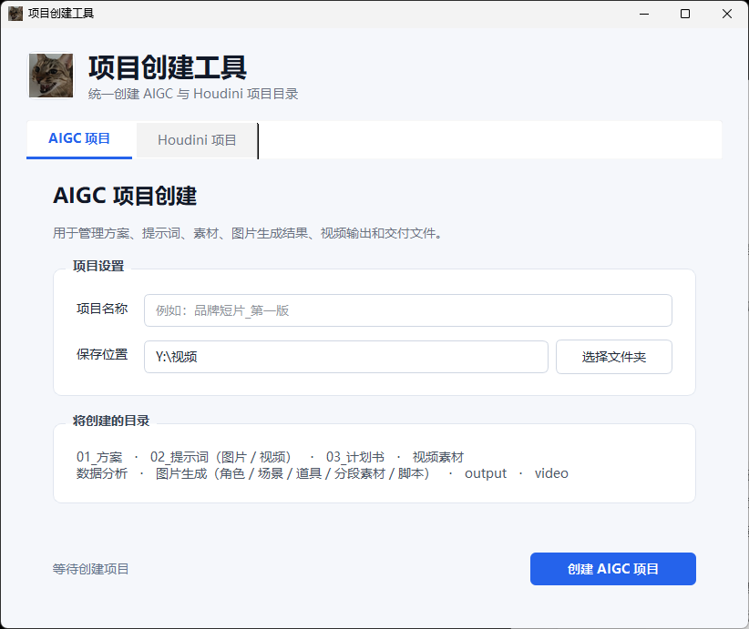

# 项目创建工具

Windows 桌面工具，用于快速创建统一的 AIGC 项目和 Houdini 项目目录结构。界面使用 PySide6。

## 软件介绍

项目创建工具提供 AIGC 项目和 Houdini 项目两种模板，通过简单的表单快速生成统一目录结构。下面是软件界面截图：



## 功能

- 创建 AIGC 项目：方案、提示词、计划书、素材、图片生成和视频输出目录。
- 创建 Houdini 项目：参考、输入、hip、otls、镜头、cache、render、comp 和输出目录。
- Houdini 项目可一次创建多个镜头目录。
- 单实例运行，重复启动时提示已有实例。
- 创建失败时显示中文错误提示。

## 运行

需要 Windows、Python 3.10+ 和 PySide6：

```powershell
py -3 -m pip install -r requirements.txt
py -3 main.py
```

也可以双击「启动项目创建工具.bat」。默认保存位置为当前用户的 Videos 文件夹，可在界面中选择其他父目录。

## 目录结构

- `main.py`：PySide6 主窗口和项目创建逻辑。
- `项目创建工具.ico`：应用图标。
- `启动项目创建工具.bat`：Windows 启动入口。
- `requirements.txt`：运行依赖。

## 安装包

本仓库的 `v1.0.3` 发布页提供 Windows 安装包。安装包适用于不想单独配置 Python 环境的用户。

## 许可证

原创代码采用 MIT 许可证，见 `LICENSE`。PySide6 等依赖保留各自许可证。
